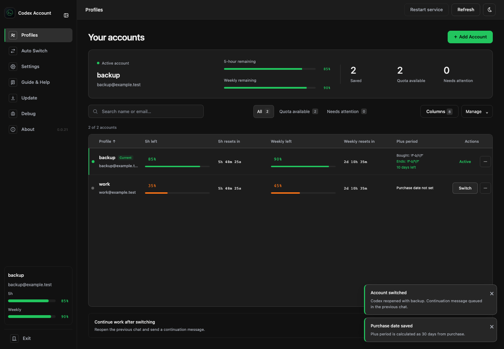

# Codex Account Manager

Codex Account Manager is a desktop app for people who use more than one Codex account. Save named profiles on your computer, compare their remaining quota, and switch accounts without repeating the sign-in flow. The same local Python core powers the desktop app, command-line tools, and browser panel.

[Download a release](https://github.com/aarefhosseini/Codex-Account-Manager/releases) · [Changelog](CHANGELOG.md) · [Troubleshooting](docs/troubleshooting.md)



## Install

The desktop builds target Apple Silicon Macs and 64-bit Windows PCs. The packaged app includes its Python core. Install Codex Desktop separately for desktop switching, and make the Codex CLI available for account login and other CLI operations. Linux users can build from source or use the CLI and local browser panel.

| Platform | Package | Installation |
| --- | --- | --- |
| macOS (Apple Silicon) | `.dmg` | Open the disk image and drag the app to Applications. Quit Account Manager before replacing an older copy. |
| Windows (x64) | `.exe` | Run the installer and launch Codex Account Manager from the Start menu. |
| Linux | Source | Follow the development instructions below. |

Select the package for your computer on the [v0.1.3 release page](https://github.com/aarefhosseini/Codex-Account-Manager/releases/tag/v0.1.3). The release notes list the available files and their SHA-256 checksums. These community builds use ad hoc signing on macOS and are unsigned on Windows.

## Save and manage accounts

1. Open **Profiles** and click **Add Account**. Import your active Codex login or use the isolated sign-in flow for another account.
2. Give the profile a name you will recognize. The table shows which account is active and how much of each quota window remains.
3. Search by profile name, email, or account ID. Filter accounts with quota available or accounts that need attention.
4. Open a row to see login status, reset times, and subscription details. The row menu lets you rename, re-login, copy details, or remove the saved account.
5. Use **Manage** to import and export selected profiles as `.camzip` archives. Use **Columns** to add optional details or adjust widths. Narrow windows show account cards.

## Switch accounts and continue a chat

Click **Switch** on the target profile. Account Manager finds the installed Codex Desktop app, requests shutdown, and checks that the app and its helpers have exited. It saves a private backup, replaces and verifies the active credentials, then reopens Codex. If shutdown fails, the app reports the cause before changing the account. If the selected sign-in cannot be verified, the previous credentials are restored. If relaunch fails after verification, the app tells you which step failed.

With **Continue work after switching** enabled, Account Manager opens the last identifiable local chat and queues a single instruction to continue unfinished work using `codex queue --resume`. This needs a compatible Codex CLI and local daemon. The app checks the Codex Desktop bundle for a compatible CLI, then falls back to the system CLI. If the previous chat or a compatible CLI is unavailable, the switch still completes and the app explains why continuation was skipped. The previous chat must remain accessible under the selected account. A queued command confirms delivery to Codex. The agent still needs available quota and any approvals required by that chat.

Turn off the continuation toggle to switch without sending a message. A delivery timeout can leave the result unknown. Check the chat before submitting another instruction. For a custom Codex Desktop installation, see [configuration and storage](docs/config-and-storage.md).

## Quota and subscription tracking

The dashboard shows remaining quota in the five-hour and weekly windows and the time until each resets. Refresh the active profile or all saved accounts from the app. Settings lets you choose separate automatic refresh intervals. A missing quota value appears as unavailable.

The desktop **Plus period** column checks each saved profile for a renewal date, scheduled end date, or a renewal date that has passed when you open Profiles and when you click **Refresh**. It checks again every 10 minutes while Profiles is open. Dates use the Persian calendar with English digits. The lookup uses the saved Codex sign-in with an undocumented ChatGPT account endpoint, which may be unavailable for some accounts. If no billing date or status is available, you can enter a receipt date under **Purchase date / Plus period** in the row menu. That fallback is labeled **Estimated end** and uses 30 days from purchase.

**Auto Switch** lets you choose which profiles are eligible, set quota thresholds and a delay, and order a switch chain manually or by ranking. You can cancel a pending switch, run a one-time switch, or use the built-in test controls. Native notifications can report pending switches and show quota status. macOS has menu-bar controls, while Windows and Linux use a tray. Windows also offers a taskbar quota overlay and a mini meter.

The desktop app includes light, dark, and system themes, keyboard navigation, reduced-motion support, a debug view, and an **Update** screen that checks this repository's releases.

## CLI and local browser panel

Install the CLI from a checkout or pin it to a release. Python 3.11 or newer is required for the standalone CLI.

```sh
pipx install 'git+https://github.com/aarefhosseini/Codex-Account-Manager.git@v0.1.3'
codex-account --help
codex-account save work
codex-account add personal --device-auth
codex-account list --json
codex-account usage-local --watch
codex-account switch work
codex-account ui
```

The browser panel opens on `127.0.0.1:4673` by default. The CLI also supports isolated commands with `run`, profile archive import and export, service autostart, and optional `codex-auth` commands. See the [CLI reference](docs/cli-reference.md), [local API](docs/ui-api.md), and [architecture](docs/architecture.md).

## Data and privacy

The app keeps profile credentials, backups, settings, and purchase dates on your device under `CODEX_HOME` (normally `~/.codex`). Quota and login operations contact the services that Codex uses. Update checks contact GitHub. A `.camzip` file contains authentication material. Keep exports private and omit credentials, logs with account details, and service tokens from public issue reports. See the [security policy](SECURITY.md) and [storage reference](docs/config-and-storage.md).

## Build from source

Use Python 3.11+, Node.js, and npm. The packaged build runs PyInstaller on the target operating system. Build the Windows installer on Windows with x64 Python, and the Apple Silicon package on an ARM64 Mac.

```sh
git clone https://github.com/aarefhosseini/Codex-Account-Manager.git
cd Codex-Account-Manager
python -m pip install -e .
python -m pip install -r electron/requirements-python-core.txt
cd electron
npm ci
npm run dev
```

Run `npm run dist:mac -- --arm64 --publish never` on Apple Silicon or `npm run dist:win -- --x64 --publish never` on Windows. The installer appears in `electron/dist`. The Linux build command is `npm run dist:linux -- --publish never`. Set `CAM_ELECTRON_PYTHON` if the build should use a specific Python executable.

Run the Python suite with `python -m unittest discover -s tests` at the repository root. Run `npm test` and `npm run build` inside `electron`. The Windows release workflow builds the installer and runs the bundled core's diagnostics on a Windows runner.

## Credits and license

This project builds on [alisinaee/Codex-Account-Manager](https://github.com/alisinaee/Codex-Account-Manager). The upstream contributors wrote the original desktop app, CLI, and browser panel. The project is an independent community tool for Codex. See the [MIT license](LICENSE) and [contribution guide](CONTRIBUTING.md).
